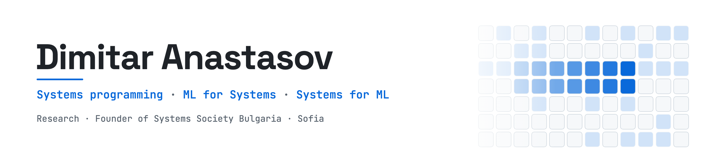

<picture>
  <source media="(prefers-color-scheme: dark)" srcset="assets/banner-dark.png">
  
</picture>

  
  
  

### 👋 Hi, I'm Dimitar

I build software close to the machine, and I like proving that it works with numbers. I'm a student at TUES in Sofia.

### 🔭 What I do

<table>
  <tr>
    <td width="50%" valign="top">
      <h4>⚙️ Systems programming</h4>
      Memory allocators, task queues, compilers and operating-system internals, down to how the processor and its caches really run the code.
    </td>
    <td width="50%" valign="top">
      <h4>🧠 ML for Systems</h4>
      Software that learns from its own behaviour which work to keep, which to schedule first and which to drop when resources run out.
    </td>
  </tr>
  <tr>
    <td width="50%" valign="top">
      <h4>🚀 Systems for ML</h4>
      Making machine learning run where memory and compute are tight: training and inference on the device, with no GPU required.
    </td>
    <td width="50%" valign="top">
      <h4>🔬 Research</h4>
      Writing research papers on learned decisions inside systems software, with measurements anyone can run again.
    </td>
  </tr>
</table>

### 🎯 Skills

  
  
  
  
  
  
  
  

### 🌍 Community

I founded **Systems Society Bulgaria**, a community for people in Bulgaria who build and study computer systems: processors, operating systems, memory, compilers and the software that runs close to the hardware.

### 🧩 What I've worked on

- ⚙️ **Systems:** memory allocators, a task queue, a compiler, parallel image compression
- 🤖 **Robotics:** autonomous robots with on-board computer vision and machine learning
- 📈 **Optimization:** finding where the time and the memory go, and taking them back
- 🌐 **Web and apps:** full-stack sites and services as well; not my favourite part, but I ship it

### 🛠️ Tech

  <b>Languages</b> 
    
  <b>Systems</b> 
    
  <b>Machine learning</b> 
    
  <b>Web and apps</b> 
  

