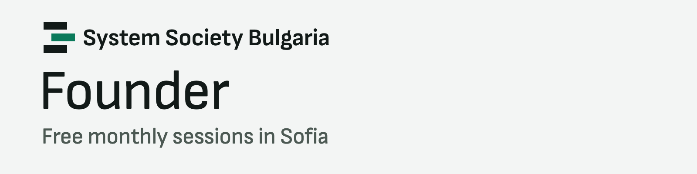
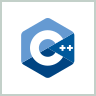
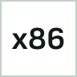
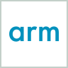
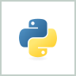
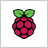
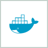

### Hi, I’m Dimitar Anastasov

**Systems programmer working on optimization: Systems for ML and ML for Systems.**

I’m a final-year student at TUES. I like putting low-level knowledge, mathematics and machine learning together to build things that didn’t exist before. Right now I’m writing research papers on ML for Systems and testing the ideas inside my own engine, [Quicx](https://github.com/anastassow/Quicx).

### Things I’ve built

<table>
<tr>
<td width="50%" valign="top">
<b>01</b>&ensp;Task queue engine in C
<h3><a href="https://github.com/anastassow/Quicx">Quicx</a></h3>
My own memory allocator and binary protocol. When memory is full, it keeps the most valuable work.
  

</td>
<td width="50%" valign="top">
<b>02</b>&ensp;Training library in C++
<h3><a href="https://github.com/Molikano/Sandokan">Sandokan</a></h3>
Neural network training on the CPU, tuned for speed. No Python and no GPU needed.
  

</td>
</tr>
<tr>
<td width="50%" valign="top">
<b>03</b>&ensp;Documentation engine
<h3><a href="https://github.com/IBM-SUMMER-PRACTICE-2026/ZDoc">ZDoc</a></h3>
Optimized documentation for mainframe and modern code, built at the IBM summer practice.
  

</td>
<td width="50%" valign="top">
<b>04</b>&ensp;Also
<h3>Compilers and robotics</h3>
A compiler for a C-style language, and autonomous robots with on-board vision and machine learning.
  

</td>
</tr>
</table>

### Community

<a href="https://linkedin.com/company/systems-society-bulgaria"><picture><source media="(prefers-color-scheme: dark)" srcset="assets/profile/ssb-dark.png"></picture></a>

I founded System Society Bulgaria for people who want to take systems programming further, into business, ML, reinforcement learning and quantum computing. Follow it on [LinkedIn](https://linkedin.com/company/systems-society-bulgaria) and come to the sessions on [Luma](https://luma.com/systems-society-bulgaria).

### Skills and main technologies

<table>
<tr>
<td valign="top" width="160"><b>Skills</b></td>
<td>

</td>
</tr>
<tr>
<td valign="top" width="160"><b>Main technologies</b></td>
<td>

 
C, C++, x86 and ARM assembly, Bash, Python, Linux, macOS, Raspberry Pi, Git, Docker
</td>
</tr>
</table>

### Also

Before all this I owned a service company and worked as a product owner. I can build web, mobile and desktop apps and set up infrastructure and networks too. It isn’t my passion anymore, but it comes in handy.

### Let’s connect

**Your network is your net worth.** Connect with me on LinkedIn.

