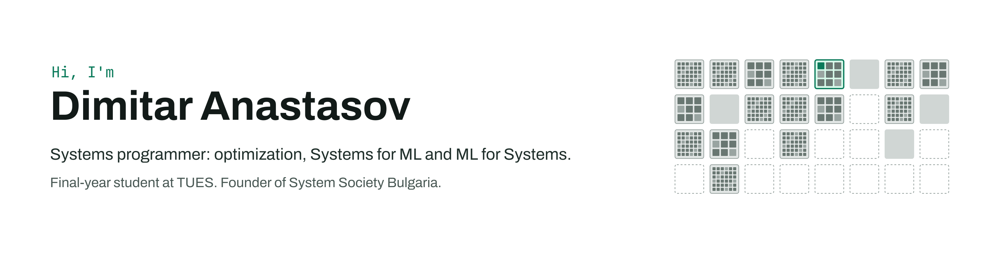
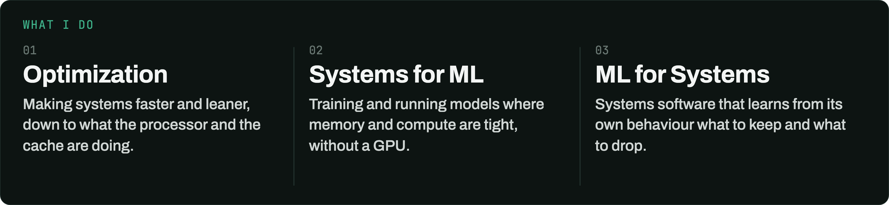
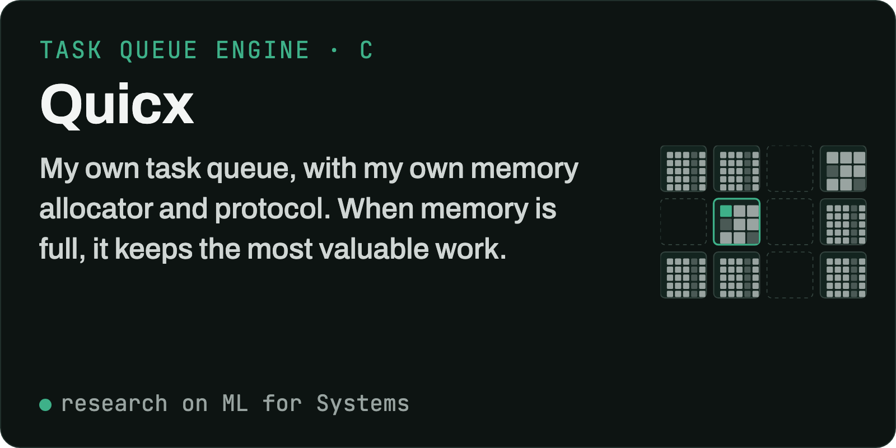
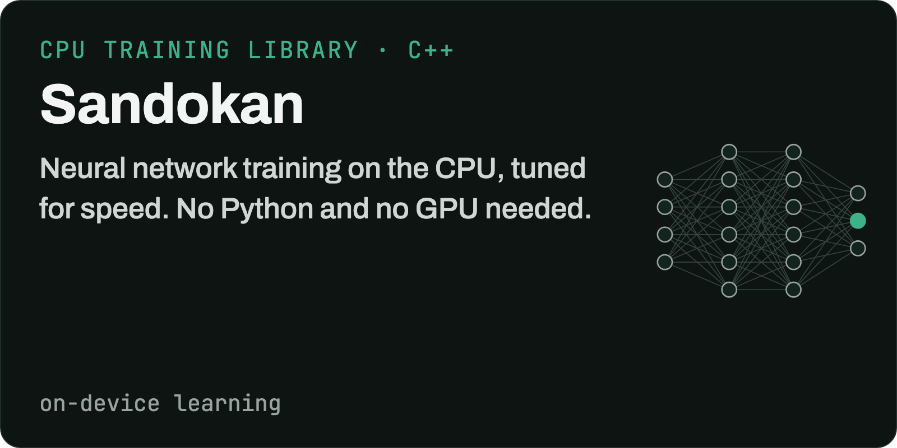
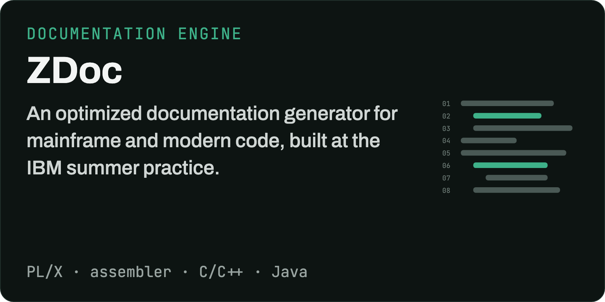
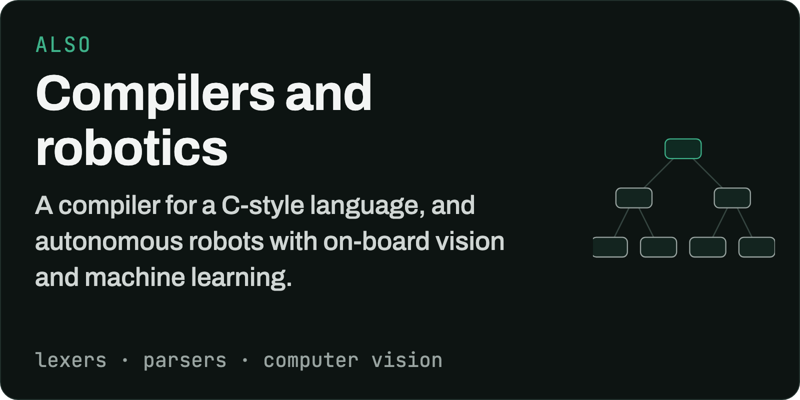
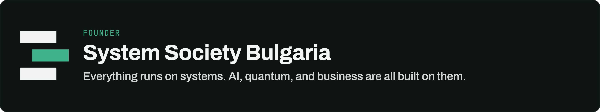

<picture>
  <source media="(prefers-color-scheme: dark)" srcset="assets/banner-2-dark.png">
  
</picture>

I'm a systems programmer. I like putting low-level knowledge, mathematics and machine learning together to build things that didn't exist before, and I'm writing research papers on ML for Systems, testing the ideas inside my own engine, Quicx.

### Things I've built

  
  
  
  

### Community

I founded System Society Bulgaria for people who want to take systems programming further, into business, ML, reinforcement learning and quantum computing. Follow it on [LinkedIn](https://linkedin.com/company/systems-society-bulgaria) and come to the events on [Luma](https://luma.com/systems-society-bulgaria).

### Also

Before all this I owned a service company and worked as a product owner. I can build web, mobile and desktop apps and set up infrastructure and networks too. It isn't my passion anymore, but it comes in handy.

### Skills

  
  
  
  
  
  
  
  

### Main technologies

You can find me on [LinkedIn](https://www.linkedin.com/in/dimitar-anastasov-339a94310/).
