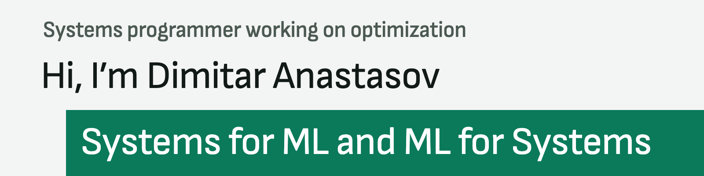
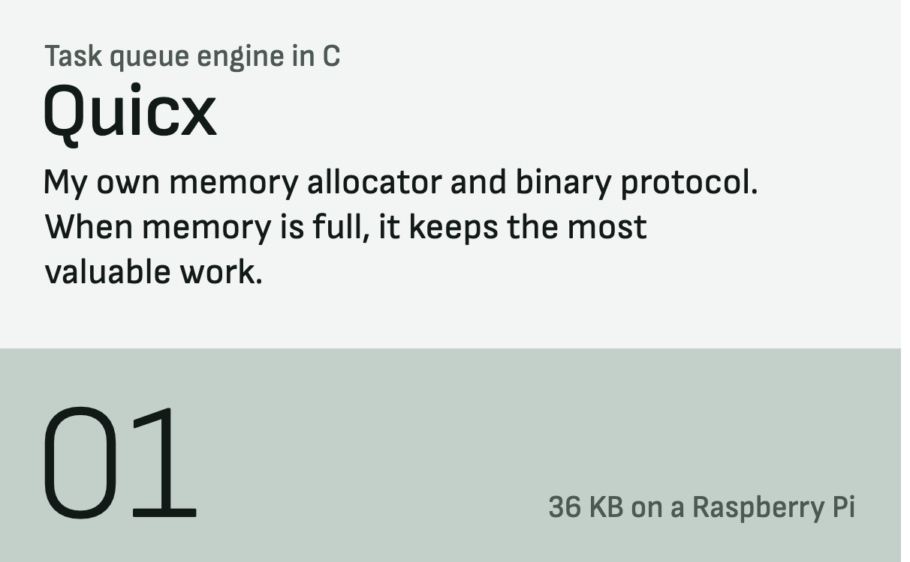
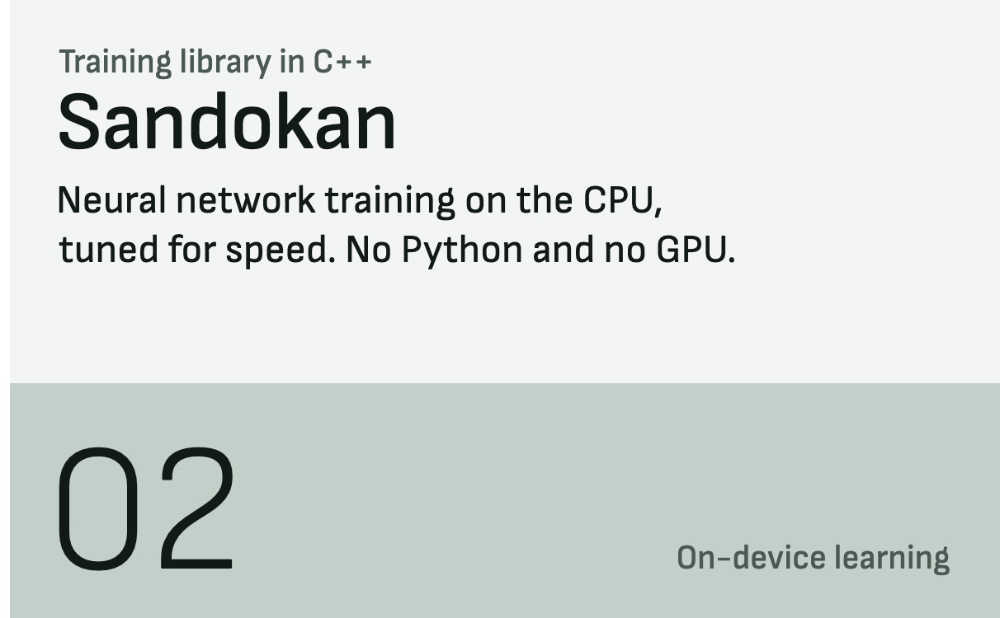
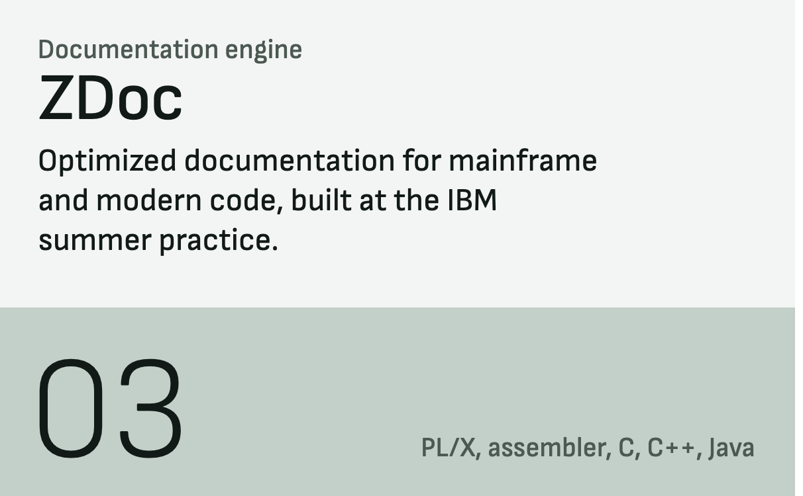
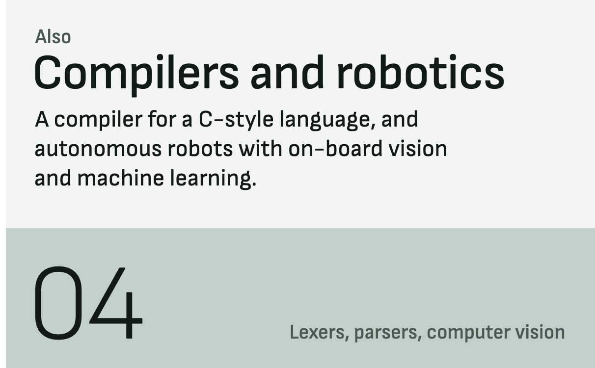
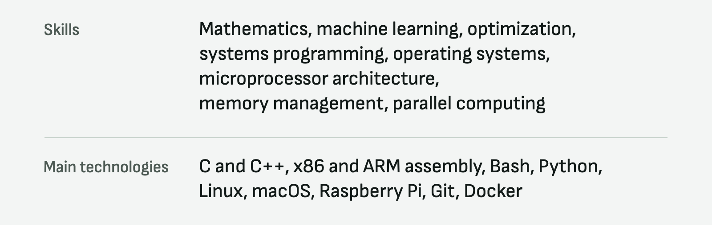

<picture>
  <source media="(prefers-color-scheme: dark)" srcset="assets/profile/banner-dark.png">
  
</picture>

I’m a final-year student at TUES. I like putting low-level knowledge, mathematics and machine learning together to build things that didn’t exist before. Right now I’m writing research papers on ML for Systems and testing the ideas inside my own engine, Quicx.

### Things I’ve built

  <a href="https://github.com/anastassow/Quicx"><picture><source media="(prefers-color-scheme: dark)" srcset="assets/profile/work-quicx-dark.png"></picture></a><a href="https://github.com/Molikano/Sandokan"><picture><source media="(prefers-color-scheme: dark)" srcset="assets/profile/work-sandokan-dark.png"></picture></a>
  <a href="https://github.com/IBM-SUMMER-PRACTICE-2026/ZDoc"><picture><source media="(prefers-color-scheme: dark)" srcset="assets/profile/work-zdoc-dark.png"></picture></a><picture><source media="(prefers-color-scheme: dark)" srcset="assets/profile/work-more-dark.png"></picture>

### Community

<a href="https://linkedin.com/company/systems-society-bulgaria"><picture><source media="(prefers-color-scheme: dark)" srcset="assets/profile/ssb-dark.png"></picture></a>

I founded System Society Bulgaria for people who want to take systems programming further, into business, ML, reinforcement learning and quantum computing. Follow it on [LinkedIn](https://linkedin.com/company/systems-society-bulgaria) and come to the sessions on [Luma](https://luma.com/systems-society-bulgaria).

### Skills and main technologies

<picture><source media="(prefers-color-scheme: dark)" srcset="assets/profile/skills-dark.png"></picture>

### Also

Before all this I owned a service company and worked as a product owner. I can build web, mobile and desktop apps and set up infrastructure and networks too. It isn’t my passion anymore, but it comes in handy.

You can find me on [LinkedIn](https://www.linkedin.com/in/dimitar-anastasov-339a94310/).
